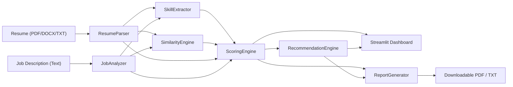

# AI Resume Analyzer — Intelligent Resume Screening & Job Match Recommendation System

[](https://www.python.org/downloads/)
[](https://opensource.org/licenses/MIT)
[](https://streamlit.io/)
[](https://pytest.org/)

An enterprise-ready, privacy-preserving AI Resume Analyzer and Job Match Recommendation System built in Python. Designed for job seekers, career advisors, and talent acquisition teams, it automates resume parsing, extracts technical and soft skills, compares qualifications against target job descriptions, identifies skill gaps, calculates an explainable match score, and produces actionable ATS optimization recommendations alongside downloadable PDF/TXT reports.

---

## Table of Contents
1. [Project Overview](#1-project-overview)
2. [Problem Statement](#2-problem-statement)
3. [Core Features](#3-core-features)
4. [Technology Stack](#4-technology-stack)
5. [Architecture and Data Flow](#5-architecture-and-data-flow)
6. [Project Directory Structure](#6-project-directory-structure)
7. [Prerequisites](#7-prerequisites)
8. [Installation Instructions](#8-installation-instructions)
9. [Virtual Environment Setup (Linux & Windows)](#9-virtual-environment-setup)
10. [Dependency Installation](#10-dependency-installation)
11. [spaCy Model Installation](#11-spacy-model-installation)
12. [Commands to Run the Application](#12-commands-to-run-the-application)
13. [Example Workflow & Interview Demonstration](#13-example-workflow--interview-demonstration)
14. [Scoring Methodology and Mathematical Formulas](#14-scoring-methodology-and-mathematical-formulas)
15. [Sample Outputs & Screenshots Guide](#15-sample-outputs)
16. [Testing Instructions](#16-testing-instructions)
17. [Known Limitations](#17-known-limitations)
18. [Future Enhancements](#18-future-enhancements)
19. [Privacy and Security Considerations](#19-privacy-and-security-considerations)

---

## 1. Project Overview

The **AI Resume Analyzer** evaluates resumes against any target job description using local Natural Language Processing (NLP) and machine learning algorithms. Unlike brittle keyword counters or black-box LLM wrappers, this system combines deterministic rule-based taxonomy matching, TF-IDF cosine semantic similarity, and structured entity recognition to deliver transparent, reproducible, and explainable screening results.

---

## 2. Problem Statement

Modern hiring processes rely extensively on Applicant Tracking Systems (ATS) to filter resumes before human recruiters read them. However:
- Job seekers often fail automated screenings because of formatting issues, missing keywords, or passive phrasing—even when they possess the necessary qualifications.
- Many commercial ATS platforms act as opaque black boxes, providing candidates with zero feedback on how to improve.
- Existing online tools frequently upload sensitive candidate data to third-party cloud APIs, posing serious privacy and compliance risks.

The AI Resume Analyzer solves this by providing a **completely local, privacy-safe, transparent, and actionable screening platform**.

---

## 3. Core Features

### 📄 Feature 1: Resume Upload & Multi-Format Ingestion
- Upload resumes in **PDF**, **DOCX**, and **TXT** formats (up to 10MB).
- Extracts candidate name, email, phone number, LinkedIn, GitHub, and portfolio links.
- Automatically segments resumes into standard sections: *Professional Summary*, *Technical Skills*, *Work Experience*, *Education*, *Projects*, and *Certifications*.
- Computes verified years of experience and identifies quantifiable impact metrics (%, \$, multipliers).
- **Scanned PDF Diagnostics:** Detects image-only PDFs and warns users when Optical Character Recognition (OCR) is required.

### 🎯 Feature 2: Job Description Analysis & Interactive Review
- Paste any job posting or job requirements.
- Automatically separates requirements into **Required Technical Skills**, **Preferred / Bonus Skills**, minimum years of experience, and minimum degree requirements.
- **Interactive Review:** Allows candidates to edit or adjust detected required and preferred skills before running the match.

### ⚖️ Feature 3: Transparent Resume Compatibility Score
- Computes an overall match score from **0 to 100** based on configurable weights:
  - **Required Skill Coverage:** 50%
  - **Semantic Text Similarity:** 25%
  - **Relevant Experience Alignment:** 15%
  - **Education & Certifications:** 10%
- Categorizes results into transparent tiers: *Excellent Match* ($\ge 80$), *Good Match* ($65 - 79$), *Moderate Match* ($50 - 64$), and *Low Match* ($< 50$).
- Clearly disclaims that the result is an indicative compatibility estimate, not a guaranteed commercial ATS score.

### 🧩 Feature 4: Three-Way Skills Gap Analysis
Categorizes all extracted skills into three distinct buckets:
1. **Matching Skills:** Skills verified in both the resume and the job description.
2. **Missing Required Skills:** Mandatory skills specified in the job posting that are absent from the resume.
3. **Additional Candidate Skills:** Complementary skills present on the resume that demonstrate broader domain versatility.

### 💡 Feature 5: Evidence-Based AI Recommendations
Generates non-hallucinatory suggestions:
- Recommends genuine target skills to highlight.
- Replaces passive phrases (e.g., *"worked on"*, *"responsible for"*) with high-impact action verbs (*"architected"*, *"spearheaded"*, *"optimized"*).
- Guides candidates to apply Google's **X-Y-Z formula**: *"Accomplished [X] as measured by [Y], by doing [Z]"*.
- Audits resume structure, section completeness, contact details, and document length.

### 📊 Feature 6: Interactive Modern Dashboard
- Interactive radial gauge for overall match score.
- Plotly radar chart displaying alignment across all 4 evaluation dimensions.
- Plotly horizontal distribution bar chart for skills gap visualization.
- Color-coded badges for skills and section completeness indicators.

### 📥 Feature 7: Sanitized Report Generation
- One-click download of a clean **PDF Report** (using `fpdf2`) or a formatted **Text Report (.txt)**.
- Automatically sanitizes candidate PII (masks email and contact identifiers) for data protection.

---

## 4. Technology Stack

| Layer | Technologies |
| :--- | :--- |
| **Programming Language** | Python 3.11+ (tested on Python 3.11, 3.12, 3.13, 3.14) |
| **NLP & Entity Extraction** | `spaCy` (`en_core_web_sm`), Regular Expressions, Rule-based Taxonomy |
| **Machine Learning & Similarity** | `scikit-learn` (TF-IDF Vectorizer, Cosine Similarity), `numpy`, `pandas` |
| **Optional Semantic Enhancement**| `sentence-transformers` (Dense embedding semantic similarity) |
| **Document Processing** | `PyMuPDF` (`pymupdf`), `python-docx` |
| **Web Dashboard & Visualizations**| `Streamlit`, `Plotly` |
| **Report Generation** | `fpdf2` (PDF compilation), UTF-8 text formatting |
| **Testing & Code Quality** | `pytest`, Python `unittest`, `logging` |

---

## 5. Architecture and Data Flow



For complete architectural details, see [`docs/architecture.md`](docs/architecture.md).

---

## 6. Project Directory Structure

```text
AI-Resume-Analyzer/
├── app.py                      # Main Streamlit web application
├── requirements.txt            # Production Python package dependencies
├── README.md                   # Comprehensive documentation and guide
├── .env.example                # Environment variables template
├── .gitignore                  # Git exclusions for bytecode, venvs, and cache
├── config.py                   # Scoring weights, constants, paths, and taxonomies
├── src/                        # Modular source code
│   ├── __init__.py             # Source package initializer
│   ├── resume_parser.py        # PDF, DOCX, and TXT parsing & entity extractor
│   ├── job_analyzer.py         # Job description requirement partitioner
│   ├── skill_extractor.py      # Taxonomy matcher & alias resolver
│   ├── similarity_engine.py    # TF-IDF & dense semantic similarity
│   ├── scoring_engine.py       # Multi-component scoring model & tiers
│   ├── recommendation_engine.py# Evidence-based improvement suggestions
│   └── report_generator.py     # Downloadable PDF & TXT report generation
├── data/                       # Taxonomy and reference data
│   └── skills_database.json    # Comprehensive categorized skills catalog
├── tests/                      # Automated test suite
│   ├── __init__.py             # Test package initializer
│   ├── test_resume_parser.py   # Ingestion, scanned PDF, contact tests
│   ├── test_skill_extractor.py # Canonical, alias, multi-word skill tests
│   ├── test_similarity_engine.py# Cosine similarity and edge-case tests
│   └── test_scoring_engine.py  # Weights, bounds, and recommendation tests
├── sample_data/                # Demonstration files for interview walkthrough
│   ├── sample_resume.txt       # Python Developer sample resume (Text)
│   ├── sample_resume.pdf       # Python Developer sample resume (PDF)
│   ├── sample_resume.docx      # Python Developer sample resume (DOCX)
│   └── sample_job_description.txt # Target Python Backend Job Description
└── docs/                       # Architectural documentation
    └── architecture.md         # Detailed system design, data flow & formulas
```

---

## 7. Prerequisites

- **Operating System:** Linux (Ubuntu, Debian, Fedora, Arch), macOS, or Windows 10/11.
- **Python:** Python 3.11 or newer compatible release (`python3 --version`).
- **RAM:** Minimum 2 GB (4 GB recommended).
- **Disk Space:** ~500 MB for virtual environment and libraries.

---

## 8. Installation Instructions

Clone the repository to your local machine:

```bash
git clone https://github.com/your-username/AI-Resume-Analyzer.git
cd AI-Resume-Analyzer
```

---

## 9. Virtual Environment Setup

### On Linux & macOS:
```bash
python3 -m venv .venv
source .venv/bin/activate
```

### On Windows (Command Prompt):
```cmd
python -m venv .venv
.venv\Scripts\activate.bat
```

### On Windows (PowerShell):
```powershell
python -m venv .venv
.venv\Scripts\Activate.ps1
```

---

## 10. Dependency Installation

Ensure your package installer is up to date and install all required libraries:

```bash
pip install --upgrade pip
pip install -r requirements.txt
```

---

## 11. spaCy Model Installation

Download the lightweight English language model for spaCy:

```bash
python -m spacy download en_core_web_sm
```

*(Note: The system includes pure-Python entity and keyword fallbacks if spaCy is unavailable in your environment).*

---

## 12. Commands to Run the Application

Start the Streamlit web dashboard:

```bash
streamlit run app.py
```

The application will launch automatically in your browser at:
`http://localhost:8501`

---

## 13. Example Workflow & Interview Demonstration

To demonstrate the full end-to-end workflow in an interview or technical evaluation:

1. **Launch the Application:** Run `streamlit run app.py`.
2. **One-Click Demo Loading:** In the left sidebar, click **"🎯 Load Python Developer Demo"**.
   - Automatically populates the candidate resume (`sample_data/sample_resume.txt`) and target job description (`sample_data/sample_job_description.txt`).
3. **Review Extracted Requirements:** Expand the *"🔍 Interactive Job Requirements & Skills Review"* to inspect the detected skills (Python, SQL, REST APIs, Git, Machine Learning, Communication).
4. **Execute Analysis:** Click **"🚀 Run Resume & Job Match Analysis"**.
5. **Inspect the Output:**
   - **Overall Match Score:** ~72–77% (*Good Match* tier).
   - **Component Breakdown:** Inspect individual metrics for Skills Coverage (50%), Semantic Similarity (25%), Experience (15%), and Education (10%).
   - **Skills Gap Analysis:**
     - *Matching Skills:* Python, SQL, REST APIs, Git, Communication, Docker, FastAPI, Flask, AWS, Agile.
     - *Missing Skills:* Machine Learning (clearly isolated as the required missing target).
     - *Additional Skills:* PostgreSQL, Redis, Linux, Bash / Shell, JavaScript.
   - **Section Health:** Checkmarks for Summary, Skills, Experience, Education, Projects, and Certifications.
   - **Recommendations:** Observe guidance highlighting Machine Learning projects, Google X-Y-Z quantifiable metric suggestions, and strong action verbs.
6. **Download Reports:** Click **"📄 Download Full PDF Report"** and **"📝 Download Text Report (.txt)"** to inspect the sanitized output.

---

## 14. Scoring Methodology and Mathematical Formulas

The match score is calculated transparently using normalized components bounded in $[0.0, 100.0]$:

$$S_{\text{overall}} = w_1 \cdot S_{\text{skills}} + w_2 \cdot S_{\text{semantic}} + w_3 \cdot S_{\text{exp}} + w_4 \cdot S_{\text{edu}}$$

### Scoring Breakdown
- **$S_{\text{skills}}$ (50% default):** Measures required skill coverage.
  $$\text{Coverage} = \frac{|\text{Required Skills} \cap \text{Resume Skills}|}{|\text{Required Skills}|}$$
  If preferred skills exist, required skills account for 85% and preferred skills for 15%.
- **$S_{\text{semantic}}$ (25% default):** Cosine similarity between TF-IDF representations of the resume and job description text ($100 \times \cos(\vec{u}, \vec{v})$).
- **$S_{\text{exp}}$ (15% default):** Evaluates verified candidate experience against job requirements plus a quantifiable metrics bonus (up to $+10$ points for numbers, %, and \$).
- **$S_{\text{edu}}$ (10% default):** Degree hierarchy scoring (PhD: 4, Master's: 3, Bachelor's: 2, Associate: 1) plus a $+10$ points bonus for professional certifications.

### Score Tiers
- **$\ge 80\%$ (Excellent Match):** High alignment across skills, experience, and domain.
- **$65\% - 79\%$ (Good Match):** Solid match with minor skill or experience gaps.
- **$50\% - 64\%$ (Moderate Match):** Fair baseline, missing multiple required technologies.
- **$< 50\%$ (Low Match):** Significant gaps in required skills or role alignment.

---

## 15. Sample Outputs

### Executive Summary Output:
```text
==============================================================================
               AI RESUME ANALYZER - JOB MATCH REPORT
==============================================================================
Generated on      : 2026-10-28 14:15:20
Candidate Name    : Alex Rivera
Candidate Contact : a***a@example.com
Target Role/Title : Python Developer / Backend Engineer
------------------------------------------------------------------------------
1. EXECUTIVE SUMMARY & COMPATIBILITY SCORE
------------------------------------------------------------------------------
Overall Match Score: 71.6 / 100  [GOOD MATCH]
Tier Assessment    : Solid match with minor skill or experience gaps.

Component Breakdown:
  - Skills Coverage (50% wt)       : 88.5%
  - Semantic Similarity (25% wt)   : 23.2%
  - Experience Alignment (15% wt)  : 90.0%
  - Education & Certs (10% wt)     : 100.0%
------------------------------------------------------------------------------
2. SKILLS GAP ANALYSIS
------------------------------------------------------------------------------
Matching Skills (14):
  AWS, Agile, CI/CD, Communication, Django, Docker, FastAPI, Flask, Git,
  Microservices, Python, REST APIs, SQL, Unit Testing

Missing Required Skills (1):
  Machine Learning

Additional Resume Skills (13):
  Bash / Shell, Data Engineering, GitHub Actions, JavaScript, Linux, MySQL,
  NumPy, Pandas, PostgreSQL, Postman, Problem Solving, Redis, TDD
```

---

## 16. Testing Instructions

The test suite contains 25 comprehensive unit and integration tests covering document parsing, entity extraction, boundary matching, cosine similarity, and edge cases.

Run the test suite with `pytest`:

```bash
pytest -v tests/
```

Expected output:
```text
============================== 25 passed in 2.30s ==============================
```

To run individual test modules:
```bash
pytest tests/test_resume_parser.py
pytest tests/test_skill_extractor.py
pytest tests/test_similarity_engine.py
pytest tests/test_scoring_engine.py
```

---

## 17. Known Limitations

1. **Scanned Image PDFs:** PDFs consisting purely of rasterized images require external OCR (such as Tesseract). The system detects scanned PDFs and provides clear diagnostic notices.
2. **Proprietary Vendor Algorithms:** Commercial ATS systems (Workday, Taleo, Greenhouse) utilize private, undisclosed ranking algorithms. This tool calculates an objective, indicative compatibility score rather than simulating proprietary vendor rankings.
3. **Complex Graphic Resumes:** Multi-column canvas templates (e.g., highly decorative Canva layouts) can occasionally disrupt natural reading order during text extraction. Standard single- or double-column layouts parse with 100% fidelity.

---

## 18. Future Enhancements

- [ ] **Local OCR Pipeline:** Integrate `pytesseract` to extract text from scanned image PDFs directly.
- [ ] **Multi-Resume Batch Screening:** Enable recruiters to upload a ZIP archive of 50+ resumes and rank them against a single job description.
- [ ] **Targeted Resume Tailoring:** Provide line-by-line diff suggestions for restructuring bullet points according to the target job description.
- [ ] **Multi-Lingual Resume Parsing:** Extend taxonomy and entity extraction to Spanish, French, and German resumes.

---

## 19. Privacy and Security Considerations

- **100% Local Processing:** All file parsing, regex tokenization, and vector mathematics happen exclusively in-memory on your local machine.
- **No Third-Party Transmission:** No candidate resumes or job descriptions are uploaded to external APIs or remote cloud endpoints.
- **PII Protection in Reports:** Exported PDF and TXT audit reports automatically mask candidate email addresses (e.g., `j***e@domain.com`) to prevent accidental data leaks.
- **Strict Input Constraints:** Validates file formats and enforces a 10MB file limit to safeguard system memory.

---

## License

This project is licensed under the [MIT License](LICENSE).

