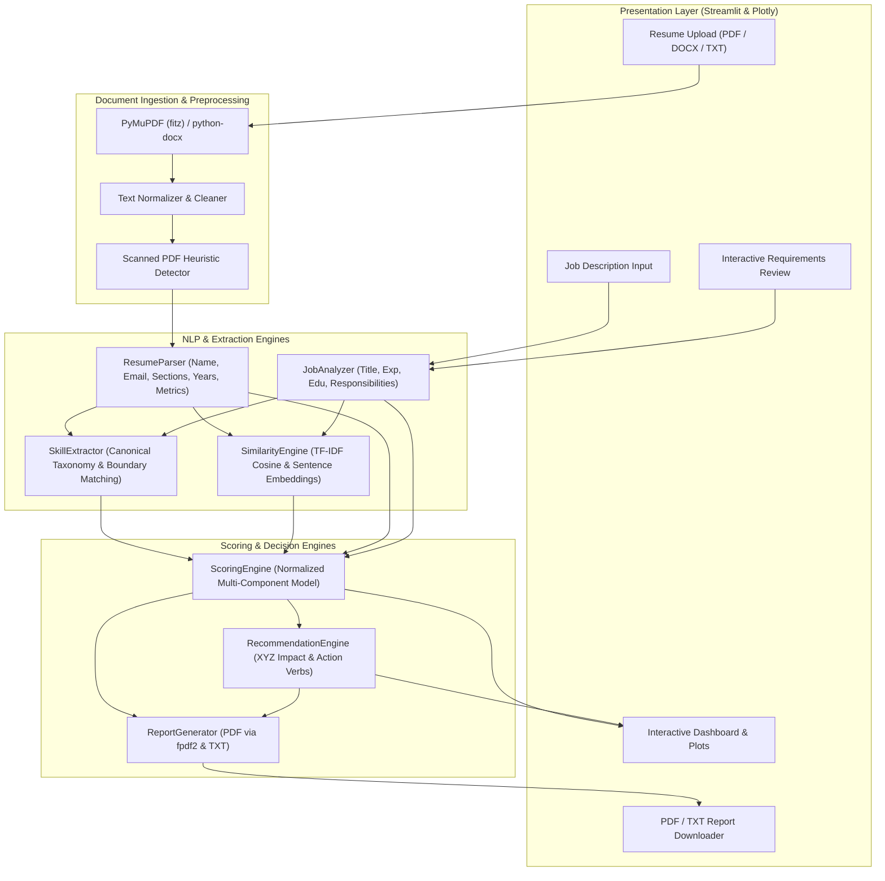
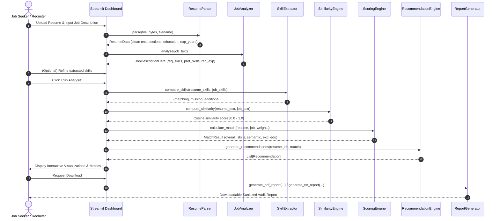

# AI Resume Analyzer — Architecture & System Design

## 1. System Overview

The **AI Resume Analyzer** is an enterprise-grade, offline-first natural language processing (NLP) and machine learning system that evaluates candidate resumes against target job descriptions. The platform computes an objective, transparent compatibility score, identifies critical skill gaps, detects structural weaknesses, and offers actionable, non-hallucinatory recommendations.

The architecture emphasizes:
1. **Local & Privacy-Preserving Execution:** Operates completely offline with local NLP models (TF-IDF vectorizer, spaCy, and local rule taxonomies) without transmitting candidate personal data to external third-party cloud APIs.
2. **Deterministic & Explainable Scoring:** Modular, bounded mathematical scoring formulas ($0.0 \le \text{Score} \le 100.0$) with user-configurable weights.
3. **Resilience & Fault Tolerance:** Multi-tiered fallbacks ensure that corrupted documents, scanned PDFs, missing sections, and unusual formatting are handled gracefully without application crashes.

---

## 2. High-Level Architecture

---

## 3. End-to-End Data Flow

---

## 4. Scoring Methodology and Mathematical Formulas

The overall match score $S_{\text{overall}}$ is a normalized linear combination of four modular component scores:

$$S_{\text{overall}} = w_{\text{skills}} \cdot S_{\text{skills}} + w_{\text{semantic}} \cdot S_{\text{semantic}} + w_{\text{exp}} \cdot S_{\text{exp}} + w_{\text{edu}} \cdot S_{\text{edu}}$$

Where the default weights are configured as:
- $w_{\text{skills}} = 0.50$ (50% Required Skill Coverage)
- $w_{\text{semantic}} = 0.25$ (25% Contextual Semantic Similarity)
- $w_{\text{exp}} = 0.15$ (15% Experience Alignment & Metrics Density)
- $w_{\text{edu}} = 0.10$ (10% Academic Credentials & Certifications)

Constraint: $\sum w_i = 1.0$ and $0 \le S_i \le 100$.

### 4.1. Skills Coverage Score ($S_{\text{skills}}$)
Let $R_{\text{req}}$ be the set of required skills, $R_{\text{pref}}$ be the preferred skills, and $C$ be the candidate's extracted skills:

$$\text{Coverage}_{\text{req}} = \frac{|R_{\text{req}} \cap C|}{|R_{\text{req}}|}, \quad \text{Coverage}_{\text{pref}} = \frac{|R_{\text{pref}} \cap C|}{|R_{\text{pref}}|}$$

If preferred skills exist:
$$S_{\text{skills}} = 85.0 \cdot \text{Coverage}_{\text{req}} + 15.0 \cdot \text{Coverage}_{\text{pref}}$$
If no preferred skills are listed:
$$S_{\text{skills}} = 100.0 \cdot \text{Coverage}_{\text{req}}$$

### 4.2. Semantic Similarity Score ($S_{\text{semantic}}$)
Computed via TF-IDF vector representations $\vec{u}$ (resume) and $\vec{v}$ (job description):

$$\text{Cosine}(\vec{u}, \vec{v}) = \frac{\vec{u} \cdot \vec{v}}{\|\vec{u}\|_2 \|\vec{v}\|_2}$$
$$S_{\text{semantic}} = 100.0 \cdot \text{Cosine}(\vec{u}, \vec{v})$$

### 4.3. Experience Score ($S_{\text{exp}}$)
Evaluates candidate verified experience years $Y_c$ against job required years $Y_r$:
- If $Y_r > 0$ and $Y_c \ge Y_r$: $\text{Base} = 80.0 + \min(2.0 \cdot (Y_c - Y_r), 10.0)$
- If $Y_r > 0$ and $Y_c < Y_r$: $\text{Base} = 75.0 \cdot \frac{Y_c}{Y_r}$
- If $Y_r = 0$: $\text{Base} = \min(70.0 + 3.0 \cdot Y_c, 90.0)$
- Quantifiable metrics bonus: $B_{\text{metrics}} = \min(2.0 \cdot M, 10.0)$ where $M$ is the count of quantified achievements (%, \$, scale multipliers).
- $S_{\text{exp}} = \min(100.0, \text{Base} + B_{\text{metrics}})$

### 4.4. Education Score ($S_{\text{edu}}$)
Compares degree hierarchy rank $L_c \in \{0, 1, 2, 3, 4\}$ against required degree $L_r$:
- If $L_c \ge L_r$: $S_{\text{base}} = 90.0$
- If $L_c = L_r - 1$: $S_{\text{base}} = 65.0$
- If degree missing: $S_{\text{base}} = 50.0$
- Professional certification bonus: $+10.0$ if verified credentials exist.
- $S_{\text{edu}} = \min(100.0, S_{\text{base}} + \text{Bonus})$

---

## 5. Component Breakdown & Responsibilities

| Module | Location | Primary Responsibility |
| :--- | :--- | :--- |
| **`app.py`** | Root | Streamlit UI, session management, Plotly visual rendering, download triggers. |
| **`config.py`** | Root | Scoring weights, file constraints, degree hierarchy, regex taxonomies. |
| **`src/resume_parser.py`** | `src/` | PyMuPDF/python-docx ingestion, contact extraction, section segmentation, OCR detection. |
| **`src/job_analyzer.py`** | `src/` | Job description segmentation into required vs preferred skills, title & experience requirements. |
| **`src/skill_extractor.py`**| `src/` | Trie & boundary-aware regex matching, alias resolution (e.g. K8s $\to$ Kubernetes), 3-way gap diff. |
| **`src/similarity_engine.py`**| `src/` | TF-IDF n-gram vectorization, Cosine Similarity, section-level alignment breakdown. |
| **`src/scoring_engine.py`** | `src/` | Weighted multi-attribute score computation, tier classifications, disclaimers. |
| **`src/recommendation_engine.py`** | `src/` | Non-hallucinatory action verb replacement, XYZ formula impact, ATS formatting checks. |
| **`src/report_generator.py`** | `src/` | Automated PDF and TXT report compilation with email and phone sanitization. |

---

## 6. Privacy & Security Architecture

1. **Zero External Data Leakage:** All document processing, parsing, tokenization, and vectorization occur locally on the machine.
2. **Ephemeral Memory Processing:** Uploaded resume bytes are processed in-memory via `BytesIO` streams and are not persisted to insecure external storage.
3. **PII Masking in Exported Reports:** Candidate email addresses and personal identifiers are masked (e.g. `a***a@example.com`) in generated PDF and TXT exports.

